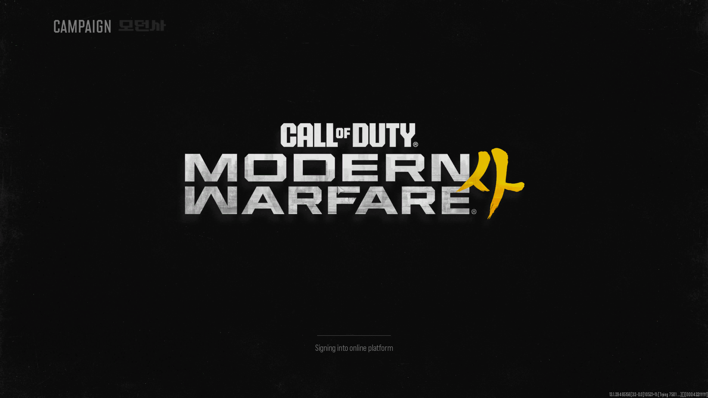
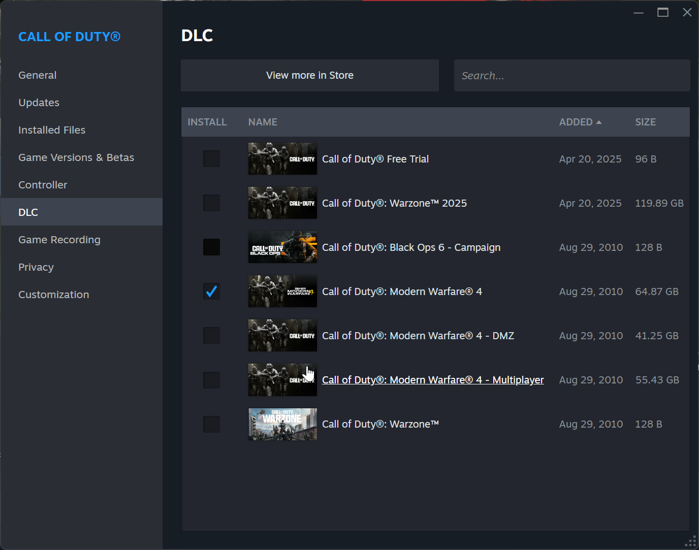
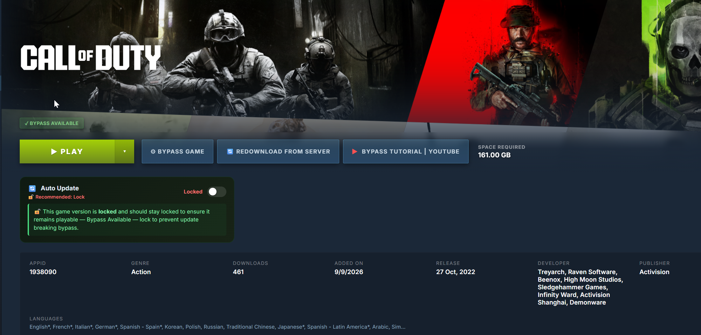
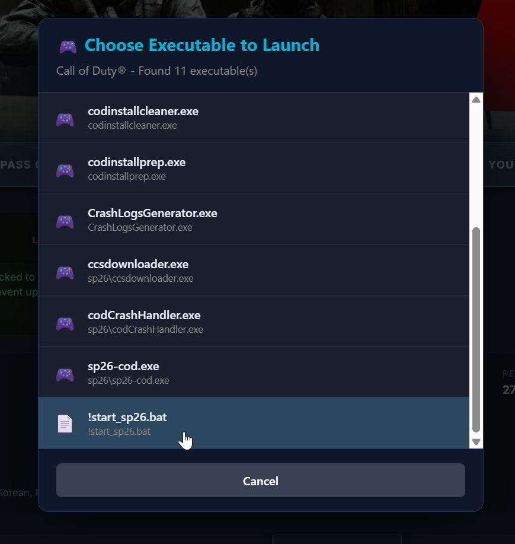
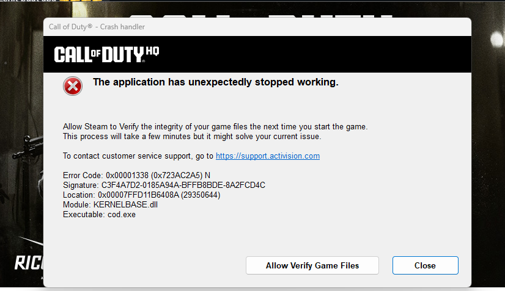

# #Call of Duty: Modern Warfare 4 - 4435490

This game is single player campaign only, so don't request for multiplayer
1. Add game from **1938090, CALL OF DUTY**.  https://cdn.discordapp.com/attachments/1561255960285155379/1561255961643982898/image.png?ex=6ad5b06b&is=6ad45eeb&hm=f806708332f83de5beb908f085cf95a5c4ec69ccd664bcae81d2cb7ee15fb547&
2. In Steam, you have to manually select only Call of Duty: Modern Warfare 4 only, others no need. Unless you want to play Black OPS 6 campaign too. https://cdn.discordapp.com/attachments/1561255960285155379/1561255961191121026/image.png?ex=6ad5b06b&is=6ad45eeb&hm=1a754ef75c071bdafc3b3f0b703a48158a880917c609789023b0b8a72a20a234&
3. Download the game
4. Click Bypass Game
5. Once completed, run the game from !start_sp26.bat https://cdn.discordapp.com/attachments/1561255960285155379/1561255962109542430/image.png?ex=6ad5b06c&is=6ad45eec&hm=831c56cccf329f5865c9c170d9a0a4df065708a671d96b69afa6cb79d1618756&

---

Call of Duty: Modern Warfare 4 - 4435490

---

Got these problems???

### 🛠️ Steam Download & Game Fix Guide

Hey everyone! If you're running into issues, follow these steps carefully to get it sorted:

**Step 1️⃣: Redownload from Server**
> Open Steam Unlock > library > **1938090, CALL OF DUTY** and click **Redownload from server**.

**Step 2️⃣: Clear Download Cache**
> Open **Steam Unlock**, go to **Tools**, and select **Clear Steam download cache**
> Wait a moment for it to finish updating.

**Step 3️⃣: Bypass Again**
> Perform the **bypass** step once more.

**Step 4️⃣: Launch from Folder**
> Finally, navigate directly to the game's folder and try launching the game from there (`!start_sp26.bat`)

> ⚠️ **If clicking the `.bat` file does nothing or doesn't popup:**
> Please run **`!start_sp26.bat`** as administrator!

---

#Call of Duty: Modern Warfare 4 - 4435490

---

note from dev

> On v1 release, i forgot to re-add a static SteamID into configs.user.ini which causes the emu (or the game) to regenerate random SteamID upon game exit that causes the existing save files to not get loaded on the next game boot. Re-adding it back in v2 fixes it.
> 
> But if you've already progressed enough in the campaign and want to restore your old progress without starting over, then follow this steps:
> 
> - Navigate to "C:\Users\<username>\AppData\Local\Activision\Call of Duty\players"
> - Take a note of the SteamID of the numbered folder (the oldest created) that contains your already existing save files
> - Open configs.user.ini in both "sp26\steam_settings\" and "sp26\steam_settings\local_saves\settings\" and put the SteamID that you've noted earlier on "account_steamid"
> - Done

---

### 📥 How to Restore Your Old Save Files

**Step 1: Locate your save folder**
Head over to this directory on your PC:
`C:\Users\<username>\AppData\Local\Activision\Call of Duty\players`

**Step 2: Find your original SteamID**
Look through the numbered folders inside and find the **oldest created folder**. The folder name is your original **SteamID**—make a note of it!

**Step 3: Update your config files**
Open `configs.user.ini` in **both** of these locations using any text editor (like Notepad):
1. `sp26\steam_settings\`
2. `sp26\steam_settings\local_saves\settings\`

Find the line reading `account_steamid` and replace it with the **SteamID** you noted down in Step 2. Save the files.

**Step 4: You're all set!**
Boot up the game, and your campaign progress should load right back up. Let us know if you run into any issues! 🎮✨

---

Tutorial Install

https://vt.tiktok.com/ZSgkjb1Vr

Credit to: <@596720616195883010>

---

Run this if you want to run a game from steam,ignored all window popup

[Download cod_run_steam.bat (0.0 MB)](assets/call-of-duty-modern-warfare-4-4435490_1562345937773395988.bat)
