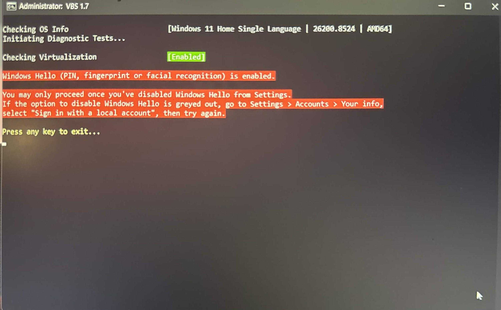

# #VBS

## Guide Disable Windows Hello

https://www.youtube.com/watch?v=Vzm2YQDcsfw

---

#VBS

---

v2.0

Temporary removes AVX-512 support for the session to make HV work with newer Denuvo versions

[Download VBS_2.0.cmd (0.1 MB)](assets/vbs_1570052296174346381.cmd)
