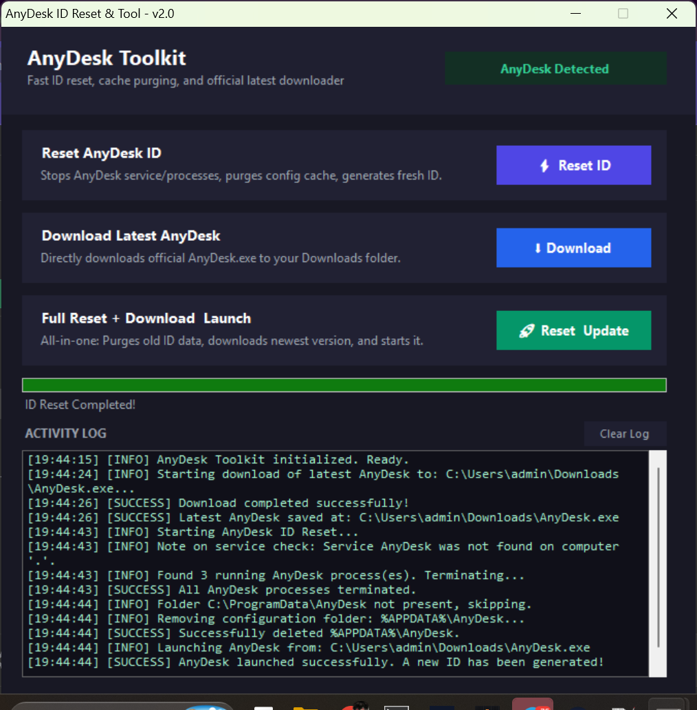

# Anydesk Toolkit

# 🛠️ AnyDesk Reset & Toolkit

A simple, lightweight utility to reset your AnyDesk ID, clean configuration caches, or download the latest official release.

### 📌 What It Does
- ⚡ **Reset AnyDesk ID**: Stops background processes/services and purges old cache files so AnyDesk generates a brand-new ID.
- ⬇️ **Download Latest**: Automatically pulls the newest official `AnyDesk.exe` from anydesk.com with live progress.
- 🚀 **Full Reset & Update**: One-click wipe + auto-download + instant launch with a fresh ID.

---

### 🚀 How to Use
1. Run **`AnyDeskTool.exe`** (or `anydesk reset.bat`).
2. Accept the **Run as Administrator** prompt when asked.
3. Pick your option:
   - Click **`Reset ID`** if you just need a new ID.
   - Click **`Download`** if you need the latest AnyDesk executable.
   - Click **`Reset & Update`** to wipe old data and launch the newest version.

---

### ⚙️ How It Works (Behind the Scenes)
1. Safely shuts down running AnyDesk instances and the Windows background service.
2. Deletes old identity tokens from:
   - `C:\ProgramData\AnyDesk`
   - `%APPDATA%\AnyDesk`
3. Restarts the service and launches AnyDesk, which registers as a brand new client.

> ⚠️ **Note:** Resetting will clear your recent session history and saved favorites.

---

[Download AnyDeskTool.exe (0.0 MB)](assets/anydesk-toolkit_1561718980207452271.exe)

---

Anydesk Toolkit
