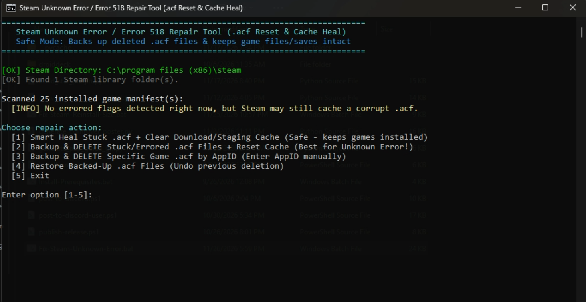

# Fix Unknown Error

## 🛠️ Steam "Unknown Error" / Error 518 Fix (`Fix-Steam-Unknown-Error.bat`)

Still getting **Unknown Error** when downloading, updating, or launching a game on Steam?
Download and run **`Fix-Steam-Unknown-Error.bat`** attached below to safely repair or rebuild stuck `.acf` manifests.

### 📋 How to Use
1. Download **`Fix-Steam-Unknown-Error.bat`** and double-click it to run.
2. The script scans all your Steam library folders and lists any stuck or errored games.
3. Choose an option:
   - **`[1]` Smart Heal Stuck `.acf` + Clear Cache** — Best first try. Clears `downloading`/`temp`/`httpcache`, fixes `StateFlags` & `UpdateResult`, and keeps games installed.
   - **`[2]` Backup & Delete Stuck `.acf` Files** — Use this if Unknown Error keeps coming back. Deletes broken `.acf` files (with automatic backups) and refreshes Steam cache.
   - **`[3]` Backup & Delete Specific AppID** — Enter a game's Steam AppID manually (e.g. `3241660`) to reset just that game's `.acf`.
   - **`[4]` Restore Backed-Up `.acf` Files** — One-click undo if you want to restore deleted `.acf` files.

### ⚠️ After Using Option `[2]` or `[3]`
- Wait for Steam to finish restarting, then click **Install** on the game into the **same Steam library folder**.
- Steam will say **"Discovering existing files"** and rebuild a clean `.acf` without redownloading your game.

### 🔒 Safe Mode Guarantee
- Your game files (`steamapps\common`), saves, and Lua scripts are **never touched**.
- Every deleted `.acf` is automatically backed up to `<Steam>\cloud_redirect\acf_backups\`.

---

[Download Fix-Steam-Unknown-Error.bat (0.0 MB)](assets/fix-unknown-error_1575474109880475668.bat)
