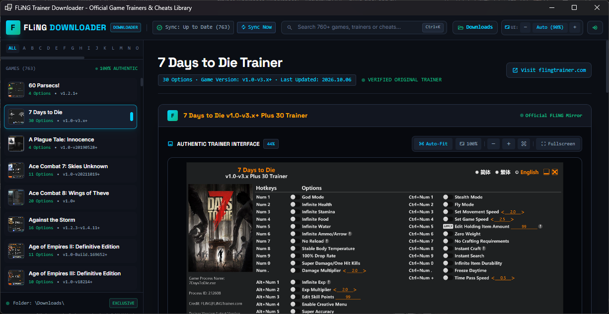

# FlingTrainer Downloader

# 🎮 FLiNG Trainer Hub & Downloader v1.0

A lightweight, standalone desktop catalog & 1-click downloader for all **FLiNG Trainers** — fast, clean, and zero bloat.

### 🌟 What Can It Do?

> ⚡ **1-Click Direct Downloads**
> Instant high-speed downloads bypassing browser popups, ads, and 403 referrer blocks.

> 📦 **Smart Auto-Extraction**
> Auto-inspects files (`.exe` vs `.zip`). Zip archives are automatically extracted into clean subfolders so trainers are ready to run instantly!

> 🔍 **760+ Game Trainer Library**
> Instant offline/cached search across the entire FLiNG catalog with cover art, version tags, and full release notes.

> 📋 **Built-in Hotkey Cheatsheet**
> View all cheat hotkeys (`Numpad 1`, `Ctrl+F1`, etc.) directly inside the app with 1-click copy. (Acts purely as a safe downloader & reference — no risky memory injection).

> 📁 **Dedicated Downloads Vault**
> Keeps your PC organized: all downloads are saved exclusively to the `Downloads\` folder with quick "Open File" and "Open Folder" buttons.

> 🖥️ **Sleek Dark Mode & Auto-Fit UI**
> Native Windows dark title bar with responsive auto-zoom that adapts to any window or display size without black bars.

> 🔄 **Live Sync**
> Checks and pulls newly released trainers directly from FLiNG on startup.

---
### 🚀 How to Use
1. Run `FlingTrainer.exe`
2. Search for your game & click **Download Trainer**
3. Launch your trainer right from the app or find it ready-to-use in `Downloads\`!

---

[Download FlingTrainer.exe (0.1 MB)](assets/flingtrainer-downloader_1563043810613788682.exe)

---

FlingTrainer Downloader

---

📢 **MAINTENANCE NOTICE**

> **Type:** One-Time Maintenance ⚠️ 

**Note:** This was a one-time maintenance update. If it stops working in the future, it means it is no longer working and **will not** receive further updates or patches

Thank you for your understanding!
