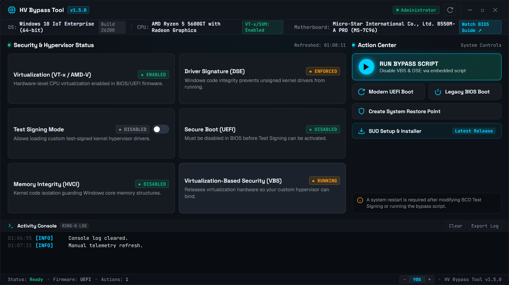

# HV tools - Legacy

# ⚡ HV Bypass Tool v1.5.0

> A modern standalone desktop utility to configure Windows hypervisor settings, check BIOS virtualization, manage test signing, and streamline system setup.

### 🚀 What is HV Bypass Tool?
**HV Bypass Tool v1.5.0** replaces legacy batch scripts with a compiled standalone Windows application (`.exe`). It provides a centralized dashboard to inspect your system's hypervisor state, configure boot flags, and safely prepare your PC for custom hypervisors and test-signed drivers.

### 🌟 Key Features

* **🖥️ Live Subsystem Telemetry**
  * Real-time monitoring for **6 core security layers**:
    * `Virtualization (VT-x / AMD-V)`
    * `Driver Signature Enforcement (DSE)`
    * `Test Signing Mode (BCD)`
    * `Secure Boot (UEFI)`
    * `Memory Integrity (HVCI)`
    * `Virtualization-Based Security (VBS)`
  * Direct YouTube guide links for your motherboard brand (ASUS, MSI, Gigabyte, ASRock, etc.).

* **⚡ Automated Bypass Script Runner**
  * One-click execution of embedded VBS/DSE bypass script.
  * **Windows Hello Safeguard**: Prompts warning if PIN/biometrics are active to prevent lockouts.

* **🔄 Quick Firmware Reboot**
  * Restart directly into **UEFI / BIOS Settings** (`shutdown /r /fw`) without mashing F2/DEL keys.

* **🛡️ Safety Restore Points**
  * One-click Windows System Restore snapshot of BCD and registry settings.

* **📦 Integrated SUO Installer**
  * Direct GitHub installer for Steam Unlock ONENNABE with live download progress.

### 💾 How to Run
1. Download **`hv1.5.0.exe`**
2. Right-click and choose **Run as administrator**.

---

[Download hv1.5.0.exe (1.8 MB)](assets/hv-tools-legacy_1562152284320825415.exe)

---

