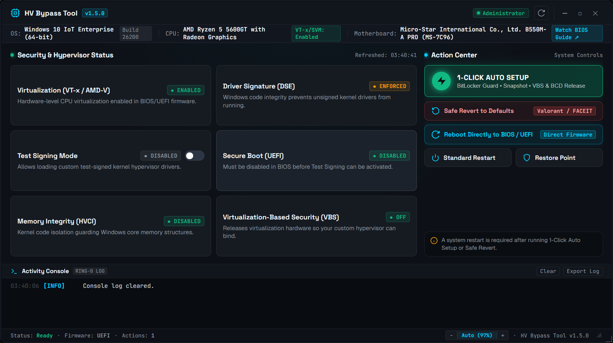
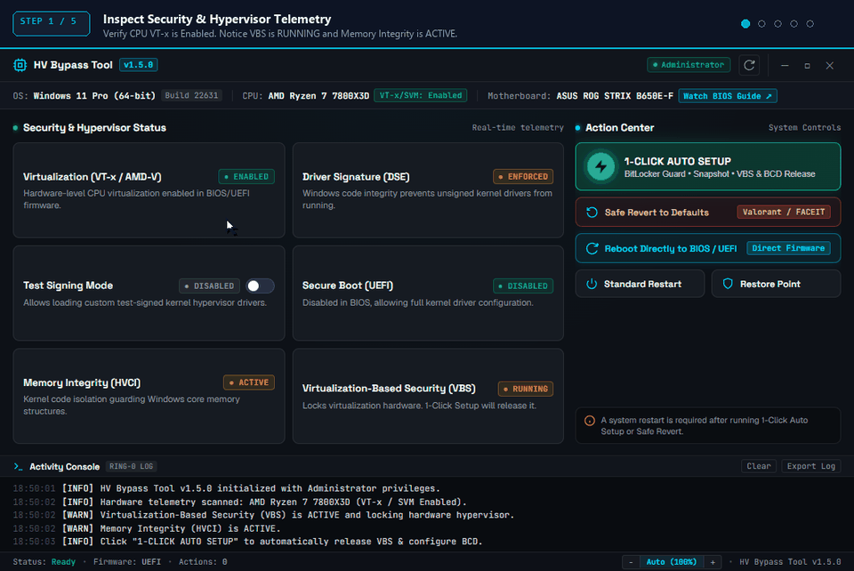

# HV tools - Legacy

# ⚡ HV Bypass Tool `v1.5.3`

> **Lightweight, portable Windows utility for Hypervisor, VBS & HVCI management.**
*Single-file native `.exe` (`2.2 MB`) • Zero installation • Modern Dark UI*

---

### 🛡️ What is HV Bypass Tool?
A specialized system utility designed to safely inspect, toggle, and configure Windows Virtualization-Based Security (**VBS**), Hypervisor-Protected Code Integrity (**HVCI**), and Test Signing modes—featuring automated bootloader sanitation to prevent boot recovery loops.

---

### ⚙️ Core Functions & Features

- **⚡ 1-Click Auto Setup (`Enter`)**
  Automated setup pipeline: automatically generates a restore snapshot, tunes kernel isolation parameters, and safely disengages VBS/HVCI without causing Windows Hello PIN lockouts.

- **🔄 Safe Revert to Defaults (`R`)**
  Instantly restores stock Windows security parameters for **Valorant / Vanguard / FACEIT**. Purges stale BCD redirects so your PC never gets trapped in recovery loops (`0xc0000189`).

- **💻 Interactive Console (`V`)**
  Launch the low-level `VBS.cmd` maintenance console directly from within the app.

- **📊 Live Ring-0 & Hardware Telemetry**
  Real-time audit of your CPU virtualization (`VT-x / AMD-V`), Secure Boot state, DSE bypass, Test Signing, and HVCI memory isolation.

- **🚀 Direct BIOS / UEFI Reboot**
  1-click restart directly into motherboard UEFI/BIOS firmware without spamming keyboard keys.

- **💾 System Restore Point Guard**
  Create immediate native Windows System Restore snapshots before applying modifications.

- **🔄 Built-In Hot-Swap Auto-Updater**
  Verifies releases against the repository and self-updates in seconds with zero manual downloads.

---

### ⌨️ Quick Hotkeys
- `Enter` ➔ Run 1-Click Auto Setup
- `R` ➔ Safe Revert to Stock Settings
- `V` ➔ Open Interactive VBS Script

---
*Portable standalone executable • Run as Administrator • Windows 10/11 x64*

---

``bcdedit /import C:\HV_BCD_Backup.bcd /clean`` Just in case need restore boot at Troubleshoot ➔ Advanced options ➔ Command Prompt

---

---

Just press "1-click Auto Setup" or click enter and restart

[Download HVBypassTool.exe (2.2 MB)](assets/hv-tools-legacy_1565695910325911663.exe)

---

**📢 Future Update Notice**

Starting from this version, updating is fully automatic:

1. Click **`Check Update`** inside the app.
2. The app will automatically download the new build.
3. Old files will be replaced automatically.

No need to re-download manually or replace folders yourself! 🚀
