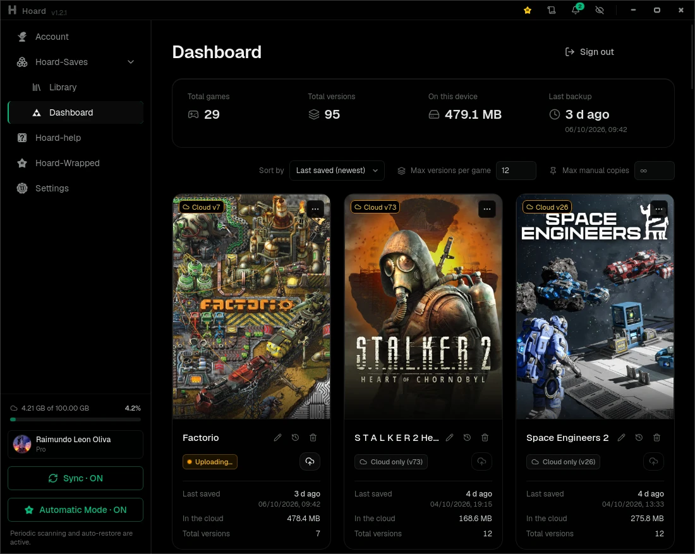

# Hoard - Cloud Saves

# 📦 Hoard Setup & Usage Guide
-# Automatic, versioned game save backup & cross-device sync (Windows, Linux, SteamOS & macOS)

## 📋 Overview
Hoard automatically detects 22,000+ games and emulators, watches your save folders in the background, and keeps a full version history so you can sync across PCs or roll back corrupted saves anytime.
* **Hoard One (Cloud):** Free tier includes **2 GB storage**, up to **3 devices**, and full version history.
* **Self-Hosted:** Run your own server via Docker/Unraid with no account or storage limits.

## 1️⃣ Step 1: Download & Install
1. Grab the desktop installer for your OS from [hoard.services](<https://hoard.services/>).
2. Launch Hoard—it runs quietly in your system tray and starts automatically on boot.
3. **Sign In:** Log in with Google or an email magic link for **Hoard One**, or enter your custom server URL and token if self-hosting.

## 2️⃣ Step 2: Detect Your Games & Emulators
1. Hoard automatically scans Steam, Epic, GOG, Xbox, Proton/Wine prefixes, and 20+ emulators using the Ludusavi database.
2. If a title or emulator isn't listed automatically, add its save folder path manually in the **Library** tab.

## 3️⃣ Step 3: Automatic Sync & Version Rollback
* **Auto-Backup:** Every time your game saves, Hoard creates a verified snapshot in the background without touching open game files.
* **Cross-Device Sync:** Close your game on one PC, let the tray icon finish syncing, and your latest save will be waiting on your second PC or Steam Deck.
* **Roll Back a Save:** Close the game, open Hoard's **Library**, select the game, and restore any earlier snapshot version.

