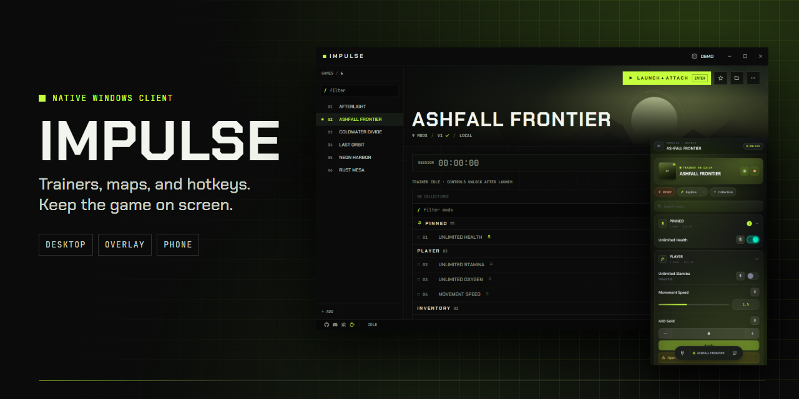

# Impulse Trainer

# ⚡ Impulse Setup & Usage Guide
-# Lightweight Windows client for game trainers (Overlay, Hotkeys & Phone Remote)

## 1️⃣ Step 1: Set Up Official Wand (WeMod) First
Impulse contains **no trainer binaries** of its own—it borrows your official Wand installation and login session.
1. Download and install the official **Wand (WeMod)** desktop app from [wand.com/download](<https://www.wand.com/download>) (Windows 10/11 64-bit).
2. Open **Wand** and **sign in** to your account *(a free account works)*.
3. **Close Wand completely** *(check your Windows System Tray in the bottom-right corner and quit it if it's still running in the background)*.

## 2️⃣ Step 2: Download & Launch Impulse
1. Grab the latest `Impulse.exe` from [GitHub Releases](<https://github.com/tweak-for-me/impulse/releases>).
2. Run `Impulse.exe` *(right-click -> **Run as administrator** if your game runs with elevated permissions)*.
3. Impulse will automatically detect your Wand login and installed games.

## 3️⃣ Step 3: Load a Game & Attach
1. Pick a game from your library list, or click **`+ Add`** to manually browse and select your game's `.exe` file.
2. Click **`Launch + Attach`** to start the game with mods ready, or launch your game normally first and click **`Attach`**.
3. *(First-time use)* Wait a few seconds while Impulse downloads the trainer files for that specific game.

## 🎮 Controls & Shortcuts
* **In-Game Overlay:** Press `Ctrl + Shift + O` while in-game to open movable panels for mods, maps, and minimaps.
* **Phone Remote:** Click the **Phone icon** in the top title bar -> toggle **Phone access** ON -> scan the QR code *(PC & phone must share the same Wi-Fi)*.
* **Hotkeys & Presets:** Rebind mod hotkeys, pin favorites, or save mod states as **Collections**

