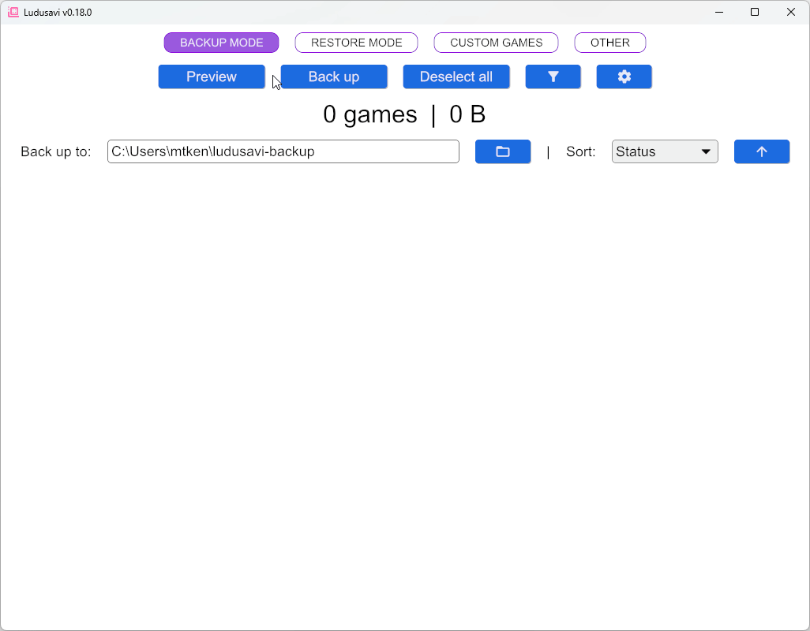

# Ludusavi - Cloud Saves

# 🛡️ Ludusavi Setup & Usage Guide
-# Open-source PC game save backup & restore tool (Windows, Linux & macOS)

## 📋 Overview
Ludusavi scans your PC for installed games across Steam, Epic, GOG, Ubisoft, EA, Xbox, Proton/Wine prefixes, and emulators—letting you back up all your local save files in one click without needing an account.

## 1️⃣ Step 1: Download & Launch
1. Grab the latest release for your OS from [GitHub Releases](<https://github.com/mtkennerly/ludusavi/releases>).
2. Unzip the files into a permanent folder *(e.g., `C:\Tools\Ludusavi`)* and launch the Ludusavi app.
3. *(Optional)* In the **Other** tab, set your preferred **Backup target directory** (such as a secondary drive, USB drive, or synced cloud folder like Google Drive/OneDrive).

## 2️⃣ Step 2: Scan & Back Up Saves
1. Open the **Backup** tab and click **`Preview`** to scan your system for all detected game saves.
2. Uncheck any games you want to skip, or leave everything selected.
3. Click **`Back up`** to copy all selected saves into clean, organized backup folders.

## 3️⃣ Step 3: Restore Saves
1. Close the game first so none of its save files are locked.
2. Open the **Restore** tab and click **`Preview`** to list your available backups.
3. Select the game (and snapshot version, if multiple exist) and click **`Restore`**.

## 💡 Useful Tips
* **Custom Save Paths:** If a game isn't detected automatically, add its save folder or registry path manually under the **Custom Games** tab.
* **Cloud Sync Workaround:** Point Ludusavi's backup folder inside your local **OneDrive, Google Drive, or Dropbox** folder to automatically sync your backups across PCs.
* **Playnite / Steam Deck:** Ludusavi integrates directly with Playnite and runs natively on Linux/SteamOS via Flatpak or AppImage.

