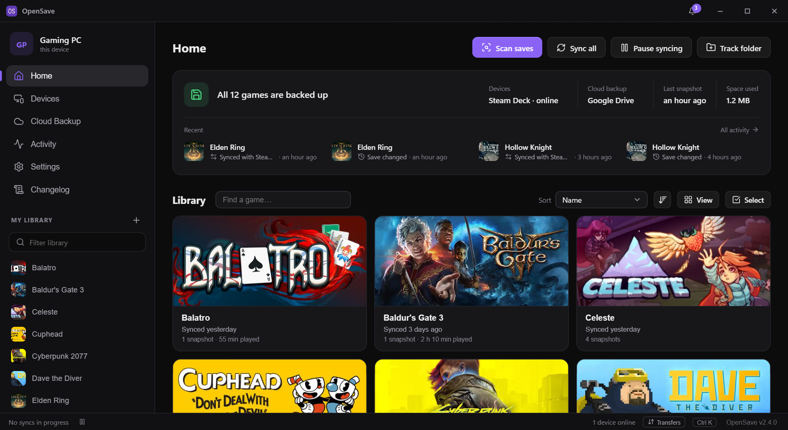

# OpenSave - Cloud Saves

# 💾 OpenSave Setup & Usage Guide
-# Open-source Steam save manager, backup tool & save swapper for Windows

## 📋 Prerequisites
* **OS:** Windows 10 or 11 (64-bit)
* **Steam:** Installed locally with your game saves synced/downloaded *(close your game before restoring or swapping saves)*.

## 1️⃣ Step 1: Download & Launch OpenSave
1. Download the latest release ZIP/EXE from [GitHub Releases](<https://github.com/Liquid-co/OpenSave/releases>).
2. Extract the archive to a permanent folder *(e.g., `C:\Tools\OpenSave`)* and run **`OpenSave.exe`**.
3. OpenSave will automatically scan your Steam installation, user accounts, and detected game save folders.

## 2️⃣ Step 2: Back Up & Restore Saves
1. **Select Account & Game:** Choose your Steam profile (if multiple exist) and pick a game from the detected list.
2. **Create Backup:** Click **`Backup`** to save a clean, timestamped snapshot of your current local save files.
3. **Restore Save:** Select any previous snapshot from your backup list and click **`Restore`** *(always close the game first so Steam doesn't overwrite your restored files)*.

## 3️⃣ Step 3: Import / Swap External Saves
1. Download or extract the external save files you want to use.
2. **Back up your existing save first** so you don't lose your original progress.
3. Open the game's save directory directly via OpenSave's **Open Folder** button (or import the save archive) and replace the files with the new save.

## 💡 Important Tips
* **Steam Cloud Warning:** If Steam Cloud is enabled, launch the game immediately after restoring a save—or temporarily toggle off **Steam Cloud** in *Steam -> Game Properties -> General*—so Steam Cloud doesn't revert your local save back to the older cloud version.
* **Custom Games:** If a non-Steam or custom game isn't auto-detected, add its save folder path manually in OpenSave.

---

OpenSave - Cloud Saves
