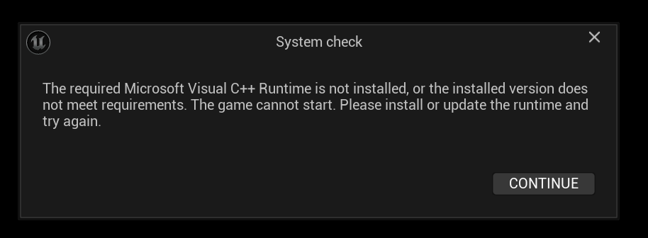
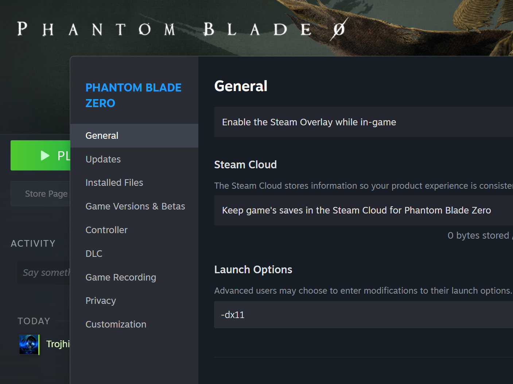

# Phantom Blade Zero - 4115450

### 🛑 1. Prerequisites
⚠️ Lock game version in SUO before downloading on Steam:
`SUO > Tools > Game Auto Update > Open > Smart Apply`

### 🛠️ 2. Bypass Setup

**Step 1:** Windows Security -> Turn **OFF** `Memory Integrity`.
**Step 2:** Turn **OFF** `Real-time Protection` & `Smart App Control`.
**Step 3:** Open Task Manager (`Ctrl + Shift + Esc`) -> Performance -> CPU -> Ensure **`Virtualization: Enabled`**.
*(If disabled, enable `VT-x` / `SVM` in motherboard BIOS).*

**Step 4: Run Script & Reboot**
Choose one script below to run:
* **Option A:** <#1562130729255567360> or <#1512676091373031507>
📹 Tutorial: <https://vt.tiktok.com/ZSgnP6BGr>
* **Option B:** https://discord.com/channels/333191744873299978/1534218459045433504
📹 Tutorial: <https://vt.tiktok.com/ZSgnfWbSy/>

> Inside script: Press **1** -> Press **1** again to reboot PC.

**Step 5:** On boot recovery screen, press **F7** *(Disable Driver Signature Enforcement)*.
**Step 6:** Open SUO -> Click **Add Game**.
**Step 7:** Download **`[GAMENAME]`** from Steam.
**Step 8:** In SUO, go to:
`SUO > Library > [GAMENAME] > Hypervisor Bypass Game`

### 🚀 3. How to Launch

* **Method 1 (Win 11):** Steam Unlock -> Click **PLAY** -> Select `HV-PlugNPlay.bat` or `HV-Launcher.bat`.
* **Method 2:** Direct run `HV-PlugNPlay.bat`, `HV-Launcher.bat`, or `[GAMENAME].exe`.
* **Method 3 (Steam):** Run `SUO > Tools > inject HV launch Option`, then launch game from Steam.

---

## If got same problems

1. Open **Steam** and go to **Library**.
2. Right-click from game , and choose **Properties**.
3. From tab **General**, find **Launch Options** and enter cmd ``-dx11``

Tutorial: <https://vt.tiktok.com/ZSgcb8h28>

*If still happen, **restart pc**

---

### ⚠️ Still Getting Errors After Adding & Restarting?

Follow these troubleshooting steps in order:

> **1️⃣ Verify Game File Integrity**
> * Open **Steam** > Right-click the game > **Properties** > **Installed Files** > **Verify integrity of game files**
>
> **2️⃣ Re-apply the Hypervisor Bypass**
> * Run the bypass tool again to re-patch
>
> **3️⃣ Launch Directly from the Game Directory**
> * Navigate to your game installation folder
> * Right-click `hvpnp.bat` > **Run as administrator** 🛡️

---

# Save Game issue?

What did work was the method mentioned by @gokugog, but it needs a bit more clarification on the directory structure. Here is the exact step-by-step that restored my progress:

# 1️⃣ . Navigate to the root save folder:
C:\Games\Phantom Blade Zero\PBZ\ProjectPBZ\Saved\SaveGames
Back up and remove the root save: Find PBZSaveGame.sav in this folder, back it up to your desktop (or another safe folder), and delete it from the original location.

# 2️⃣ . Locate your actual game progress:
Go inside the Steam ID subfolder:
C:\Games\Phantom Blade Zero\PBZ\ProjectPBZ\Saved\SaveGames\Steam\[YourSteamID]\

# 3️⃣ . Copy your active save:
Inside this folder is your regularly updated PBZSaveGame.sav. Copy it.

# 4️⃣ . Paste it into the main save folder:
Drop that copy back into C:\Games\Phantom Blade Zero\PBZ\ProjectPBZ\Saved\SaveGames (the parent directory from Step 1).

Once I launched the game after doing this, my regular save loaded up immediately.
Note: Not entirely sure yet whether the game will automatically update this file or if we have to repeat the copy/paste process after every session.
