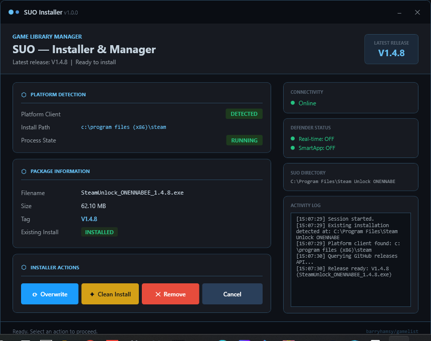

# SUO Installer

# 🎮 SUO Installer — Official Release

A modernized, standalone desktop installer and manager featuring a clean dark UI, automated system diagnostics, and one-click maintenance.

---

### ✨ Key Features
* 🔍 **Smart Client Detection** — Automatically detects your installation path and client process state.
* ⚡ **One-Click Installation Modes**:
  * `Overwrite Install` — Update existing files in place while preserving custom folders.
  * `Clean Install` — Complete reset and fresh setup.
  * `Remove / Uninstall` — Clean removal of all tool components.
* 🛡️ **System Pre-Flight Checks** — Live indicators for network connectivity and Windows Defender / SAC protection layers.
* 📦 **Auto-Fetch Releases** — Direct sync with the latest build payloads and release tags.
* 📜 **Integrated Activity Console** — Real-time progress tracking, streaming downloads, and diagnostics.

---

### 📋 Requirements
* **OS:** Windows 10 / 11 (x64)
* **Runtime:** [.NET 8 Desktop Runtime](https://dotnet.microsoft.com/download/dotnet/8.0)

---

### 📥 Download
Grab the latest standalone `.exe` from the attachments or releases channel below:

