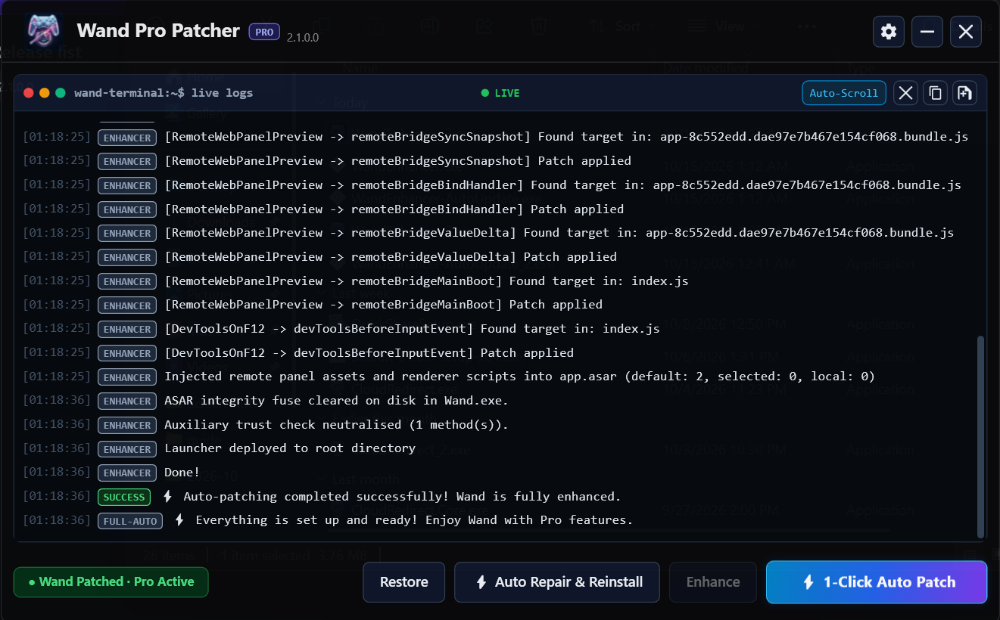
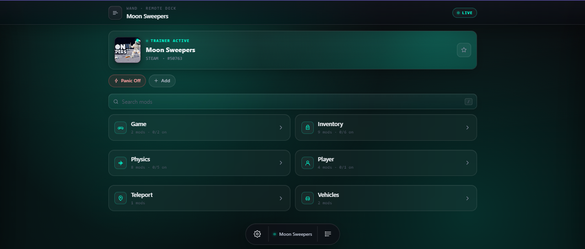
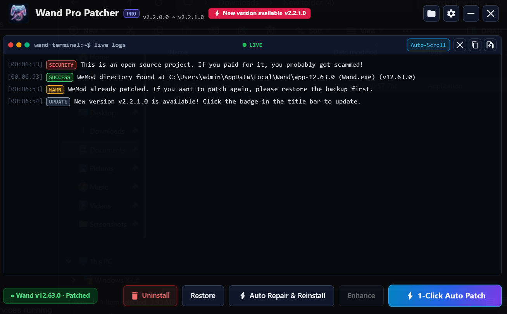

# Wand Pro

# 🪄 Wand / WeMod Auto-Updater & Tools

• **Auto-Update:** Automatically downloads and updates Wand/WeMod to the latest version.
• **Self-Healing:** Built-in auto-patch, reinstall, and repair capabilities.
• **Custom UI:** Clean **Steam Theme** integration.
• **Remote Ready:** Full support for **Wand Remote**.

---

> 💡 **Notice:** The Wand/WeMod patch is **100% free and open-source**. If you paid for this tool, you have been scammed!

---

Wand

---

🚀 **Check out WandEnhancer — Open Source Wand / WeMod Companion Tool!**

Looking to get more out of Wand? **WandEnhancer** is an open-source tool that adds remote mobile controls, unlocks pro features, and automates patching:

👉 **GitHub:** <https://github.com/k1tbyte/Wand-Enhancer>

**Key Features:**
🔹 **Mobile / Web Remote Control:** Control cheats from your phone via local Wi-Fi & QR code
🔹 **Pro Unlocked:** Full interactive controls and sliders unlocked client-side
🔹 **1-Click Auto Patch:** Fast, reliable patching with backup and auto-repair
🔹 **Update-Proof:** Auto-reapplies when the app updates
🔹 **DevTools Enabled:** Press `F12` to inspect the UI
🔹 **100% Free & Open-Source:** No shady installers, no paid keys, clean code

Download the latest release here:

---

Wand Pro

---

Mobile Interface

---

desktop interface

---

---

settings > choose which server

---

---

## 📢 Wand / WeMod Patcher — Repository & Update Notice

Due to a **DMCA notice**, I have decided to set the repository to **private** for the time being. 

In the meantime, I am working on a **new major update** that will bring several improvements, including:
* ✨ Quality of Life (QoL) enhancements
* 🌐 Improved remote connectivity
* 🎮 Better Steam connection stability

Thank you for your patience and continued support! Stay tuned for further updates

---

> # ⚡ Wand Enhancer v2.3.0.0
> -# Gaming HUD Remote Panel, Desktop Suite & Smarter Auto-Update
> 
> ## 🚀 New Features
> - **Gaming HUD Remote Panel**: Tactical UI redesign, local Steam library/launcher, 6-digit PIN lock, save backups & restore, timed macros, activity log with undo, Stream Deck triggers, Wake Lock & gamepad nav.
> - **Desktop Suite**: Diagnostics & `.zip` support bundle, Script Manager with templates, minimize to tray, global Panic Off (`Ctrl+Shift+Backspace`) & CLI flags.
> - **Smarter Auto-Update**: Background watcher self-upgrades, catches missed Wand updates, retries locks & relaunches Wand. Self-updater adds progress bar, cancel button, SHA-256 check & safe rollback.
> 
> ## 🛠️ Bug Fixes
> - Fixed broken Steam cover art in Library (local `librarycache` fallback).
> - Fixed raw translation IDs with automatic `en-US` fallback.
> - Saved toggles, strategy & scripts now persist in the Enhance menu.
> 
> > 📥 Existing installs auto-detect **v2.3.0.0**

[Download WandEnhancer-AutoUpdate.exe (4.2 MB)](assets/wand-pro_1572553807567654952.exe)
