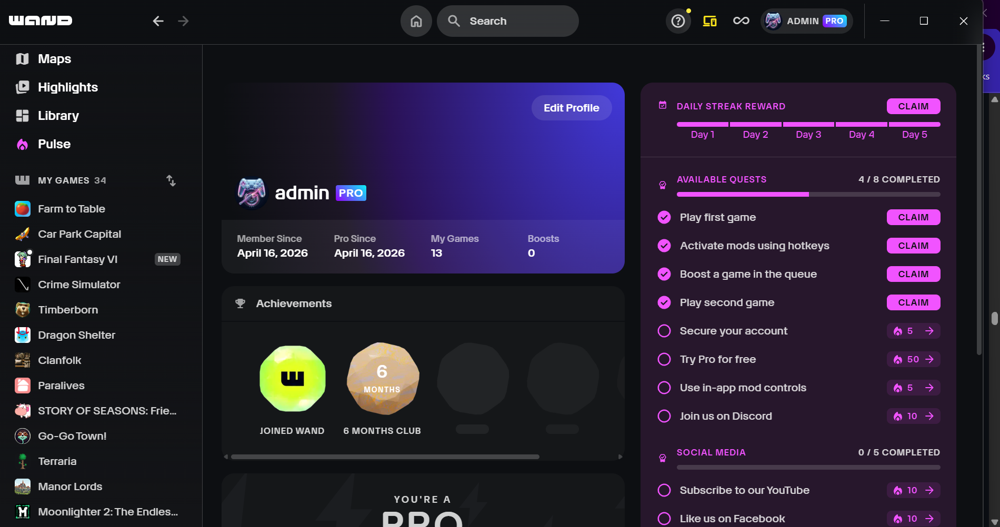

# Wand Pro

# 🪄 Wand / WeMod Auto-Updater & Tools

• **Auto-Update:** Automatically downloads and updates Wand/WeMod to the latest version.
• **Self-Healing:** Built-in auto-patch, reinstall, and repair capabilities.
• **Custom UI:** Clean **Steam Theme** integration.
• **Remote Ready:** Full support for **Wand Remote**.

---

> 💡 **Notice:** The Wand/WeMod patch is **100% free and open-source**. If you paid for this tool, you have been scammed!


---

Wand

---

### 🚨 **Pro Subscription Notice Fix**

If you encounter this popup:
> `"You No Longer Pro"`

### 📋 **Summary: Patch vs. Crack**
* **Patch:** Modifies specific files on your official app to bypass restrictions. Safe, but updates break it.
* **Crack:** Replaces the entire app with a modified pirated version. Risky (potential malware) and harder to update.

### 🛠️ **How to fix it:**
1. Run your tools again.
2. Click **Enhance**.
3. Tick **Disable Update**.
4. Click **Start**.

> **Note:** This is a patch and not a cracked app. Any new software updates will require you to apply the patch again.

---

🚀 **Check out WandEnhancer — Open Source Wand / WeMod Companion Tool!**

Looking to get more out of Wand? **WandEnhancer** is an open-source tool that adds remote mobile controls, unlocks pro features, and automates patching:

👉 **GitHub:** <https://github.com/k1tbyte/Wand-Enhancer>

**Key Features:**
🔹 **Mobile / Web Remote Control:** Control cheats from your phone via local Wi-Fi & QR code
🔹 **Pro Unlocked:** Full interactive controls and sliders unlocked client-side
🔹 **1-Click Auto Patch:** Fast, reliable patching with backup and auto-repair
🔹 **Update-Proof:** Auto-reapplies when the app updates
🔹 **DevTools Enabled:** Press `F12` to inspect the UI
🔹 **100% Free & Open-Source:** No shady installers, no paid keys, clean code

Download the latest release here:

---



---

latest update from master repo

[Download WandEnhancer.exe (3.8 MB)](assets/wand-pro_1562196648908554321.exe)

---

# 🪄 How to Use / Install WandEnchancer

**1️⃣ Download** the latest version from here
**2️⃣ Turn off** your antivirus / Smart App Control temporarily (if flagged as a false positive)
**3️⃣ Double-click** ```WandEnchancer.exe```
**4️⃣ Click** ```1-click Auto patch```

> ℹ️ *The system will automatically decide whether it needs to download the latest files or apply a patch.*

---

Wand Pro
