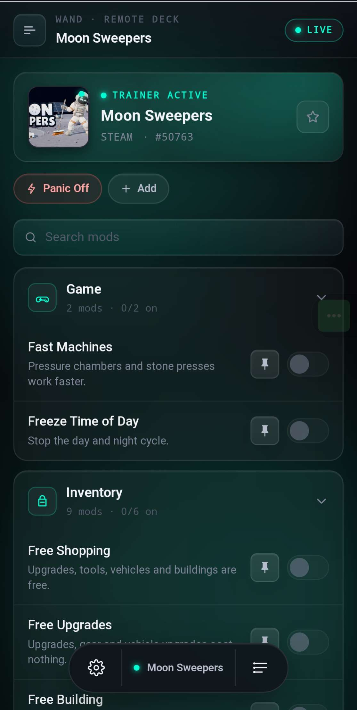
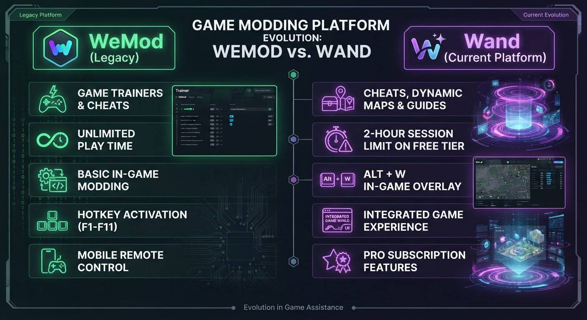
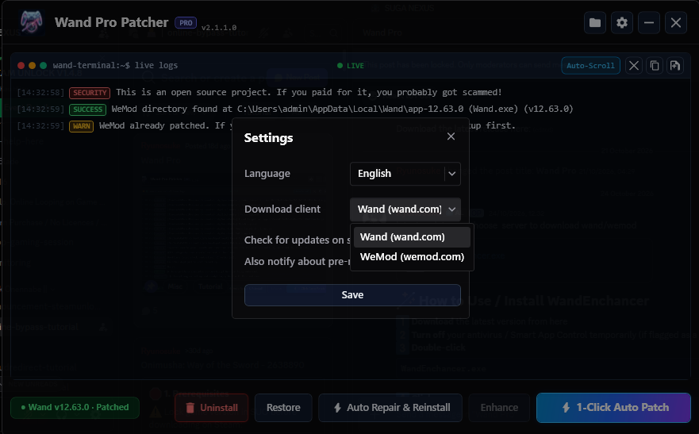

# Wand Pro

# 🪄 Wand / WeMod Auto-Updater & Tools

• **Auto-Update:** Automatically downloads and updates Wand/WeMod to the latest version.
• **Self-Healing:** Built-in auto-patch, reinstall, and repair capabilities.
• **Custom UI:** Clean **Steam Theme** integration.
• **Remote Ready:** Full support for **Wand Remote**.

---

> 💡 **Notice:** The Wand/WeMod patch is **100% free and open-source**. If you paid for this tool, you have been scammed!

---

Wand

---

🚀 **Check out WandEnhancer — Open Source Wand / WeMod Companion Tool!**

Looking to get more out of Wand? **WandEnhancer** is an open-source tool that adds remote mobile controls, unlocks pro features, and automates patching:

👉 **GitHub:** <https://github.com/k1tbyte/Wand-Enhancer>

**Key Features:**
🔹 **Mobile / Web Remote Control:** Control cheats from your phone via local Wi-Fi & QR code
🔹 **Pro Unlocked:** Full interactive controls and sliders unlocked client-side
🔹 **1-Click Auto Patch:** Fast, reliable patching with backup and auto-repair
🔹 **Update-Proof:** Auto-reapplies when the app updates
🔹 **DevTools Enabled:** Press `F12` to inspect the UI
🔹 **100% Free & Open-Source:** No shady installers, no paid keys, clean code

Download the latest release here:

---

Wand Pro

---

Mobile Interface

---

desktop interface

---

---

settings > choose which server

---

---

## 📢 Wand / WeMod Patcher — Repository & Update Notice

Due to a **DMCA notice**, I have decided to set the repository to **private** for the time being. 

In the meantime, I am working on a **new major update** that will bring several improvements, including:
* ✨ Quality of Life (QoL) enhancements
* 🌐 Improved remote connectivity
* 🎮 Better Steam connection stability

Thank you for your patience and continued support! Stay tuned for further updates

---

# 🪄 Wand Enhancer v2.4.0.0

> **Major Update:** Remote Game Termination, Live Session Timer, Ambient Poster Glow & Haptics!

### ✨ What's New
* 🛑 **Remote "Stop Game" & Force Kill**
  * Dedicated Stop Game button with confirmation modal to prevent accidental closes.
  * Terminates the game process and child helpers via `taskkill /F /T /PID` + `SIGKILL` with name fallback.
* ⏱️ **Impulse Live Session Timer**
  * Real-time timer in the header with a pulsing status dot while playing.
  * Retains and displays your last session playtime when idle.
* 🎨 **Ambient Poster Lighting**
  * Dynamically extracts colors from the active game poster to cast a soft ambient glow over the panel backdrop.
* 📳 **Haptic Vibration Feedback**
  * Micro-vibrations on toggles and buttons for mobile browsers.
  * Double-pulse warning vibration on destructive actions. Toggle in **Settings**.
* 🔍 **Multi-Platform Library Scanner**
  * Detect installed games across Steam, Epic Games, GOG, and Xbox / Microsoft Store.

### 🐛 Bug Fixes
* **Fixed Mobile Dock Overlap**: Centered confirmation dialog and auto-hid the floating dock while open.
* **Fixed Process ID Tracking**: Resolved live PID tracking across bridge runtime and renderer scripts.
* **Fixed Translation Hashes**: Fixed missing locale strings rendering as raw hash IDs

---

[Download WandEnhancer-AutoUpdate.exe (4.2 MB)](assets/wand-pro_1574762262386843750.exe)
