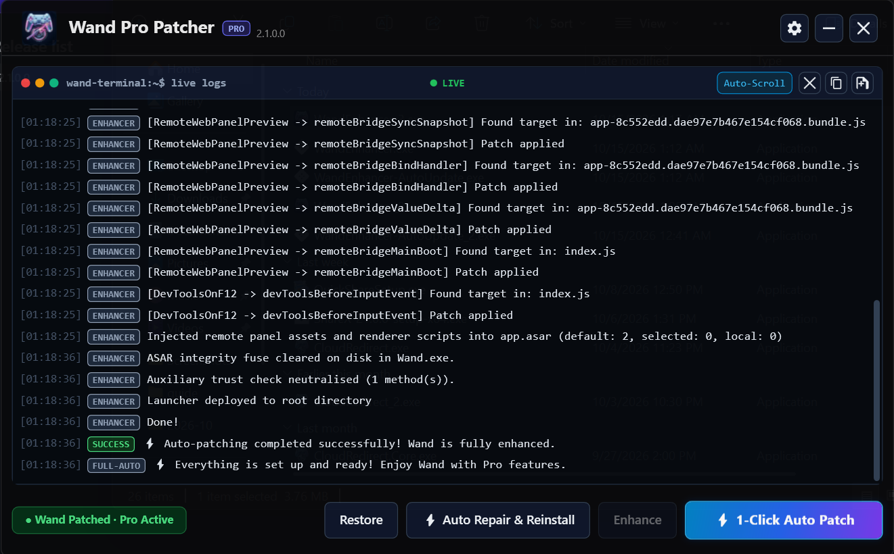

# Wand

# 🪄 Wand / WeMod Auto-Updater & Tools

• **Auto-Update:** Automatically downloads and updates Wand/WeMod to the latest version.
• **Self-Healing:** Built-in auto-patch, reinstall, and repair capabilities.
• **Custom UI:** Clean **Steam Theme** integration.
• **Remote Ready:** Full support for **Wand Remote**.

---

> 💡 **Notice:** The Wand/WeMod patch is **100% free and open-source**. If you paid for this tool, you have been scammed!

---

Wand

---

### 🚨 **Pro Subscription Notice Fix**

If you encounter this popup:
> `"You No Longer Pro"`

### 📋 **Summary: Patch vs. Crack**
* **Patch:** Modifies specific files on your official app to bypass restrictions. Safe, but updates break it.
* **Crack:** Replaces the entire app with a modified pirated version. Risky (potential malware) and harder to update.

### 🛠️ **How to fix it:**
1. Run your tools again.
2. Click **Enhance**.
3. Tick **Disable Update**.
4. Click **Start**.

> **Note:** This is a patch and not a cracked app. Any new software updates will require you to apply the patch again.

---

[Download Wand_Pro_Patcher.exe (3.8 MB)](assets/wand_1560501937286152392.exe)
